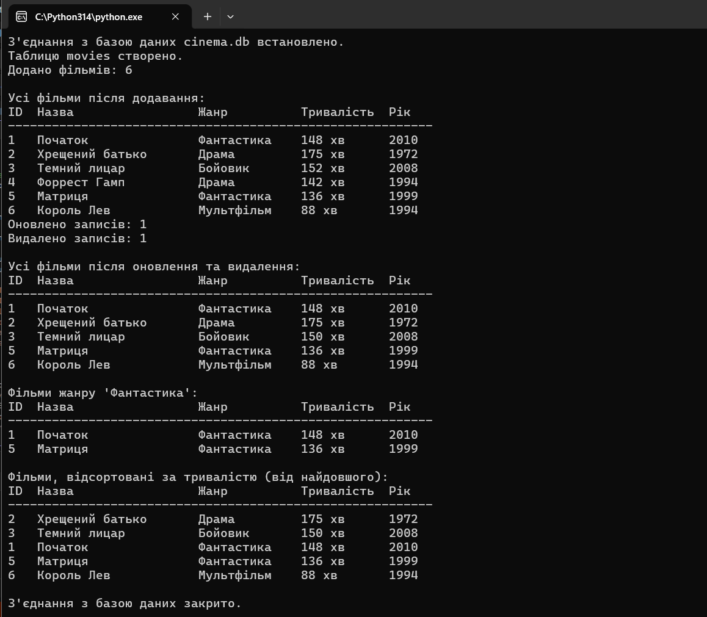
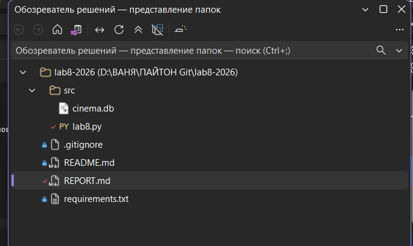

# Звіт до лабораторної роботи № 8

**Тема:** Підключення до бази даних та виконання основних операцій.

**Мета:** здобути практичні навички роботи з базами даних у мові програмування Python, навчитися виконувати базові операції (створення, вставка, оновлення, видалення, вибірка) та ознайомитися з принципами роботи з SQL.

---

## Хід роботи

### 1. Скріншоти виконання

*Додайте сюди скріншоти, що демонструють:*
1.  *Створення таблиці у вашій СУБД (наприклад, у pgAdmin).*
2.  *Результат виконання вашого Python-скрипта в терміналі.*
3.  *Вміст таблиці після виконання всіх операцій (SELECT запит у вашій СУБД).*

**(приклад)** (Замість капібар та панд продемонструйте скріншот з терміналу та скріншот з БД)

### 2. Контрольне запитання

*Вкажіть номер вашого варіанту та дайте розгорнуту відповідь на контрольне запитання.*

**Мій варіант:** `3

**Питання:** Що таке транзакції в базах даних? Навіщо вони потрібні та які властивості вони мають (ACID)?

**Відповідь:**
Транзакція — це логічна одиниця роботи з базою даних, яка складається з однієї або кількох операцій (SQL-запитів), що виконуються як єдине ціле. Або всі операції виконуються успішно (фіксуються командою `COMMIT`), або, у разі помилки, жодна з них не застосовується (відкочуються командою `ROLLBACK`). 

Вони потрібні для того, щоб захистити дані від збоїв (наприклад, вимкнення світла під час запису) та забезпечити правильну роботу, коли з базою одночасно працює багато користувачів.
Властивості транзакцій (ACID):
1. **A — Atomicity (Атомарність):** Транзакція неподільна. Виконується повністю або не виконується взагалі.
2. **C — Consistency (Узгодженість):** Транзакція переводить базу даних з одного правильного (узгодженого) стану в інший, не порушуючи правил та обмежень таблиць.
3. **I — Isolation (Ізольованість):** Транзакції, що виконуються одночасно, не заважають одна одній. Проміжні результати однієї транзакції не видно іншим до її завершення.
4. **D — Durability (Довговічність):** Якщо транзакція успішно завершена (`COMMIT`), її результати збережуться назавжди, навіть якщо після цього станеться збій системи.
---

## Висновки

Під час виконання лабораторної роботи я ознайомився з основами роботи з реляційними базами даних у мові Python. Я використав вбудований модуль `sqlite3` для підключення до локальної бази даних та отримав такі навички:
1. Автоматичне створення файлу бази даних (`cinema.db`) та створення таблиці з необхідними типами даних (INTEGER, TEXT) і первинним ключем (PRIMARY KEY).
2. Виконання базових SQL-операцій (CRUD): додавання даних (`INSERT`), оновлення записів за умовою (`UPDATE`), видалення (`DELETE`) та вибірка даних (`SELECT`).
3. Використання сортування (`ORDER BY`) та фільтрації (`WHERE`) при виконанні запитів.
4. Ознайомлення з механізмом транзакцій: всі зміни в базі фіксувалися за допомогою методу `commit()`, що забезпечувало їх збереження. Також я навчився обробляти помилки бази даних за допомогою конструкції `try-except`.

`...`
